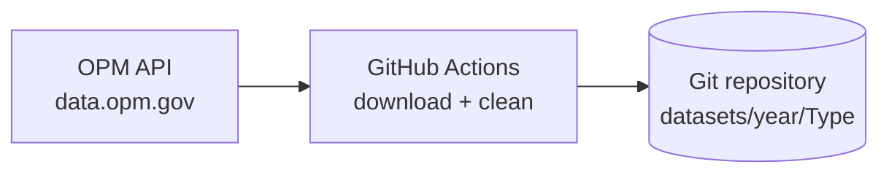

# OPM Federal Workforce Data Pipeline

An automated, reproducible pipeline that collects the U.S. Office of Personnel Management (OPM) federal workforce datasets (**Accessions**, **Separations**, **Employment**) for **2022 to 2026**, cleans them, and stores them in this repository, one folder per dataset and year, so they can be reviewed and reused.

- **Source:** [data.opm.gov API](https://data.opm.gov/get-data/api-access)
- **Period covered:** January 2022 to August 2026 (the latest month OPM had published when this was built)
- **Team:** NHA-5 (S2-105)

---

## Table of contents

1. [What this project does](#1-what-this-project-does)
2. [Architecture](#2-architecture)
3. [Data source](#3-data-source)
4. [Repository structure](#4-repository-structure)
5. [Data layout and file naming](#5-data-layout-and-file-naming)
6. [Cleaning rules](#6-cleaning-rules)
7. [Ingestion with GitHub Actions](#7-ingestion-with-github-actions)
8. [Running locally](#8-running-locally)
9. [Verification](#9-verification)
10. [Design decisions](#10-design-decisions)
11. [Troubleshooting](#11-troubleshooting)
12. [Security notes](#12-security-notes)
13. [Limitations and next steps](#13-limitations-and-next-steps)

---

## 1. What this project does

1. **Pulls** monthly Parquet files from the OPM API, one file per dataset per month.
2. **Cleans** every file with one shared function (consistent column names, placeholders turned into `NULL`, proper data types, traceability columns).
3. **Stores** the cleaned files in this Git repository under `datasets/`, organized by year and dataset, so the work can be reviewed by the instructor and the team.
4. **Updates quickly:** files that already exist are skipped, so running the pipeline again only downloads and cleans new months.

---

## 2. Architecture



The download and cleaning run on GitHub's servers (GitHub Actions), so nothing depends on the disk space or internet speed of a personal computer. The cleaned files are committed back to the repository.

---

## 3. Data source

The pipeline uses the public OPM API. No API key is required.

- **List files:** `GET https://data.opm.gov/api/v1/files/{dataset}?current=true&year={YYYY}`
  returns, for each month, `filename`, `year`, `month`, `version`, `current`, `publishDate`.
- **Download a file:** `GET https://data.opm.gov/api/v1/files/{dataset}/{year}/{month}/{version}/download`
  returns a Parquet file.

Datasets (`{dataset}` is lowercase in the API):

| Dataset         | Meaning                                                                | Approx. raw size per month (per OPM) |
| --------------- | ---------------------------------------------------------------------- | ------------------------------------ |
| `accessions`  | People who joined the federal workforce (new hires, transfers in, ...) | 60 KB to 1 MB                        |
| `separations` | People who left (resignation, retirement, transfer out, ...)           | 100 KB to 4 MB                       |
| `employment`  | Snapshot of the whole workforce for the month                          | 26 MB to 75 MB                       |

Notes about the data:

- The data is **anonymized**: there is no employee identifier. Each row is one person described by attributes (agency, grade, occupation, age bracket, ...).
- Some fields are **redacted** by OPM for privacy and security (mostly for the Department of Defense). They appear as `REDACTED` in the source.
- Files are **versioned** (`..._202201_4` means version 4). The pipeline always requests the current version (`current=true`).

---

## 4. Repository structure

```
.
├── .github/
│   └── workflows/
│       └── fetch-to-repo.yml        # pipeline: download, clean, commit
├── datasets/
│   └── <year>/<Type>/<type>_<YYYYMM>_<version>.parquet
├── docs/                            # project documents (proposal, literature review, requirements)
├── scripts/
│   ├── ingestion/
│   │   ├── fetch_to_repo.py         # downloads + cleans files from the OPM API
│   │   └── clean_lib.py             # the shared cleaning function
│   └── bronze/ silver/ gold/        # other team components (not covered here)
├── requirements.txt
├── .gitignore
├── LICENSE
└── README.md
```

---

## 5. Data layout and file naming

```
datasets/
├── 2022/
│   ├── Accessions/accessions_202201_4.parquet ... accessions_202212_4.parquet
│   ├── Employment/employment_202201_4.parquet ... employment_202212_4.parquet
│   └── Separations/separations_202201_4.parquet ... separations_202212_4.parquet
├── 2023/ ... 2025/
└── 2026/                            # January to August
```

File names follow `<dataset>_<YYYYMM>_<version>.parquet`.

Expected file counts: **12 per dataset per year for 2022 to 2025**, and **8 for 2026**, so **56 files per dataset**.

---

## 6. Cleaning rules

All cleaning is in `scripts/ingestion/clean_lib.py` (`clean(df, meta)`), and every dataset goes through the same function.

| Rule                     | Detail                                                                                                                                              |
| ------------------------ | --------------------------------------------------------------------------------------------------------------------------------------------------- |
| Column names             | trimmed, lowercased, non-alphanumeric characters replaced with `_`                                                                                |
| Text values              | leading and trailing spaces removed                                                                                                                 |
| Placeholders to `NULL` | `INVALID`, `*`, `REDACTED`, and empty strings (case-insensitive)                                                                              |
| `UNKNOWN`              | kept as is, because it is a real category in the source data                                                                                        |
| Numbers                  | `count` becomes an integer; `annualized_adjusted_basic_pay` and `length_of_service_years` become floats                                       |
| Dates                    | `appointment_not_to_exceed_date` and `service_computation_date_leave` become dates                                                              |
| Codes                    | all `*_code` columns and `grade` stay as **text**, so leading zeros are not lost (for example occupational series `0545`, grade `05`) |
| Added columns            | `data_year`, `data_month`, `source_file` identify which file every row came from                                                              |
| Duplicates               | **not removed** (see below)                                                                                                                   |

Rules that apply to a column only apply if the column exists in that dataset.

### Why duplicate rows are kept

In the Accessions file for January 2022 there are 25,546 rows and the `count` column equals 1 on every row, so the sum of `count` equals the row count (25,546). About 2,000 rows are identical to another row, but because the data has no person identifier, identical rows are different people who share the same attributes. Removing them would undercount hires, so they are kept.

### Why many columns contain `NULL`

Some columns (for example pay, duty station, bargaining unit) are empty for a large share of rows because the source marks them `REDACTED`. This is a property of the source, not a processing error. Mention it when interpreting results.

---

## 7. Ingestion with GitHub Actions

Workflow: `.github/workflows/fetch-to-repo.yml` ("Fetch OPM data to repo"). It is started manually from the **Actions** tab (**Run workflow**) and has three inputs:

| Input       | Options                                         | Purpose                |
| ----------- | ----------------------------------------------- | ---------------------- |
| `dataset` | `accessions`, `separations`, `employment` | which dataset to fetch |
| `years`   | `2022` to `2026`, or `2022-2026`          | which year(s)          |
| `months`  | `1-12`, `1-6`, `7-12`                     | which months           |

What each run does:

1. Checks out the repository and sets up Python.
2. Runs `scripts/ingestion/fetch_to_repo.py`, which for every month in range:
   - skips the file if it already exists (so runs are incremental and safe to repeat),
   - downloads the Parquet file, cleans it with `clean_lib.py`, and writes it (zstd compression) to `datasets/<year>/<Type>/`.
3. **Checks file sizes** and fails if any file is larger than 95 MB (GitHub rejects files over 100 MB).
4. **Commits and pushes one year at a time**, so no single push is too large.

The script reads its range from environment variables: `YEAR_FROM`, `YEAR_TO`, `MONTH_FROM`, `MONTH_TO` (defaults: 2022 to 2026, months 1 to 12).

### Recommended run order

| Run     | dataset     | years              | months         |
| ------- | ----------- | ------------------ | -------------- |
| 1       | accessions  | 2022-2026          | 1-12           |
| 2       | separations | 2022-2026          | 1-12           |
| 3 to 12 | employment  | one year at a time | 1-6, then 7-12 |

Wait for each run to finish before starting the next, so two runs do not push at the same time. Employment is split into small runs because its files are large.

### Monthly updates

OPM publishes monthly. To get a new month, run the workflow again for the dataset and year. Existing files are skipped, so only the new month is downloaded. A monthly `schedule:` trigger can be added to the workflow to automate this.

---

## 8. Running locally

The pipeline can also be run on a personal computer (useful for testing one month).

```powershell
git clone https://github.com/nhahub/NHA-5-105.git
cd NHA-5-105
python -m venv .venv
.\.venv\Scripts\Activate.ps1
python -m pip install pandas pyarrow requests
```

Fetch one dataset for a range of months (the defaults are 2022 to 2026 and months 1 to 12):

```powershell
$env:YEAR_FROM = '2022'; $env:YEAR_TO = '2022'
$env:MONTH_FROM = '1';   $env:MONTH_TO = '3'
python scripts/ingestion/fetch_to_repo.py accessions
```

On Linux or macOS use `export YEAR_FROM=2022` and so on. Run it from the repository root so the output goes to `datasets/`. Do not commit large Employment files from a personal computer; use the GitHub Actions workflow for that (see section 11).

---

## 9. Verification

Check that every dataset has the expected number of files.

PowerShell:

```powershell
Get-ChildItem datasets -Recurse -Filter *.parquet |
  Group-Object { $_.Directory.Parent.Name + '/' + $_.Directory.Name } |
  Select-Object Name, Count
```

Linux or macOS:

```bash
find datasets -name '*.parquet' | cut -d/ -f2,3 | sort | uniq -c
```

Expected: **12 files** for each dataset in 2022, 2023, 2024 and 2025, and **8 files** in 2026.

To check the contents of a file, open it in Python:

```python
import pandas as pd

df = pd.read_parquet("datasets/2022/Accessions/accessions_202201_4.parquet")
print(df.shape)
print(df.dtypes)
print(df["count"].sum(), len(df))   # for Accessions, these two numbers match
```

---

## 10. Design decisions

| Decision                                    | Reason                                                                |
| ------------------------------------------- | --------------------------------------------------------------------- |
| Parquet files, not CSV                      | compact, typed, fast; the source already provides Parquet             |
| Cleaning in one shared function             | identical rules for every dataset and month                           |
| Placeholders become `NULL`                | `NULL` is the correct way to represent "no value" in analysis tools |
| Codes kept as text                          | preserves leading zeros that are part of the code                     |
| Duplicates kept                             | rows are people, not records to deduplicate (section 6)               |
| Existing files are skipped                  | updates are fast and runs are safe to repeat                          |
| One year per commit                         | keeps each push small enough for GitHub                               |
| Employment processed in small runs          | large files and long download time                                    |
| Download and cleaning run on GitHub Actions | no dependence on local disk space or internet speed                   |

---

## 11. Troubleshooting

| Symptom                                                                          | Cause and fix                                                                                                                                 |
| -------------------------------------------------------------------------------- | --------------------------------------------------------------------------------------------------------------------------------------------- |
| `ModuleNotFoundError: No module named 'pandas'` (or `pyarrow`, `requests`) | the package is not installed in the active virtual environment. Run `python -m pip install pandas pyarrow requests` with the venv activated |
| `git push` rejected, `non-fast-forward`                                      | the remote has newer commits. Run `git pull --no-rebase origin main` and push again                                                         |
| `git push` fails with HTTP 408                                                 | the push is too large. Do not commit `datasets/` from a local machine; use the workflow                                                     |
| Workflow step **Check file sizes** fails                                   | a file is larger than 95 MB. Split the file or use Git LFS                                                                                    |
| Workflow shows `python: can't open file ...`                                   | the script path in `fetch-to-repo.yml` must be `scripts/ingestion/fetch_to_repo.py`                                                       |
| Script prints `No data` for a month                                            | OPM has not published that month yet                                                                                                          |

---

## 12. Security notes

- No passwords, keys, or connection strings are stored in the repository.
- Files such as `profiles.yml` and `.env` are listed in `.gitignore`.
- The workflow only needs permission to write to this repository (`contents: write`).

---

## 13. Limitations and next steps

- **Coverage:** the data stops at the latest month OPM has published (August 2026 at the time of writing). Re-run the workflow to add new months.
- **Versions:** OPM may republish a month as a new version. The pipeline downloads the current version of each month when it first sees it and does not replace a file it already has.
- **Redaction:** columns marked `REDACTED` in the source are `NULL` here and cannot be recovered.
- **Repository size:** the Employment files add up to several GB. Every clone downloads them, and the size cannot be reduced later without rewriting history.
- **Planned:** a monthly schedule for the workflow, aggregated Employment tables, and downstream cleaned and analytics layers built on top of the files in `datasets/`.

---

## License

See [LICENSE](LICENSE).
